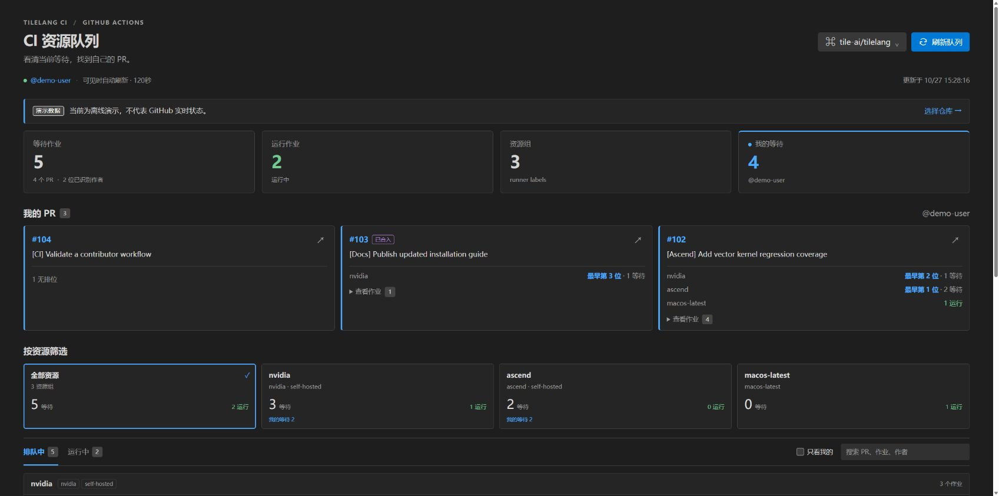

# TileLang CI



*内置离线演示的浏览器预览。图中作业为模拟数据，VS Code 另外提供原生侧栏。*

[English](README.md) | **简体中文**

在 VS Code 中查看 GitHub Actions 资源队列和自己的 PR 排位。选择仓库后，插件按实际 runner 标签分组，展示等待作业、运行作业，以及你的 PR 在各资源中的位置。

这是 **easy-tilelang** 组织维护的独立插件，与 [TileLang DevKit](https://github.com/easy-tilelang/tilelang-devkit-vscode) 同级。扩展 ID 为 `easy-tilelang.tilelang-ci-vscode`，支持任意 **github.com** 仓库，以及当前账号有权访问的私有仓库。使用时无需 Python、TileLang、GitHub CLI，也无需启动独立网页服务。

## 安装和开始使用

需要 Windows、macOS 或 Linux 上的桌面版 **VS Code 1.95+**。

1. 在扩展视图中选择 **… → 从 VSIX 安装…**，安装构建得到的 `tilelang-ci-vscode-0.1.1.vsix`；也可以执行 `code --install-extension tilelang-ci-vscode-0.1.1.vsix`。
2. 点击 Activity Bar 中的 **TileLang CI**，或在命令面板执行 **TileLang CI: 打开看板**。
3. 选择 GitHub 仓库。工作区只有一个候选时会自动选中；使用“选择仓库”可以切换 remote、最近选择的仓库，或输入 `owner/repo`、GitHub HTTPS 仓库链接。
4. 点击“连接 GitHub”，通过 VS Code 登录，自动标注由你创建的 PR。公开仓库也可匿名读取，但会受较低的 GitHub API 限额限制。
5. 查看私有仓库时，执行“授权访问私有仓库”，阅读提示并完成 GitHub 授权。

“打开演示”会加载明确标注的离线示例，不需要登录或联网。演示中的 PR 和数量仅用于说明界面；重新“选择仓库”即可退出演示，回到实时查询。

Marketplace 上架是单独的维护者发布步骤。本仓库 CI 会构建 VSIX 产物，不会自动发布插件。

## 界面和排位

- **原生侧栏**展示仓库、账号、资源组和你的活动 PR；选择条目后打开或筛选编辑区看板。
- **资源卡片**来自完整 runner 标签组合，可查看排队或运行作业，并使用搜索和“只看我的”。
- **我的 PR**按资源汇总最靠前的位置，展开后查看各个作业。同一 PR 的两个作业排在第 9、12 位时，仍占用两个作业队位。
- **已合入、已关闭、旧提交**的活动作业继续显示并标记。PR 合入后触发的发布作业仍可能等待资源。
- **尚无资源排位**保留尚未生成可展示作业的工作流，以及缺少时间或资源标签等无法排位的作业。
- **概览**区分作业数、去重 PR 数和已识别 PR 作者数；**状态栏**显示你的最近等待/运行数量，悬浮提示包含快照时间。

搜索、PR 筛选和“只看我的”都保留原始资源内队位。“全部资源”按资源分别展示，不把不同资源的第 1 位拼成一个全局排名。

## 队位的含义

队位是**当前仓库可见的 `queued` 作业，在相同标签组内按 `job.created_at`、job ID 排出的顺序**。标签忽略大小写、顺序及重复项；`self-hosted + nvidia` 和 `self-hosted + nvidia + h100` 分组显示。运行中的作业不占等待队位。

这是参考顺序，不能承诺 GitHub 的真实调度结果。作业创建时间不一定是资源就绪时间；不同标签组可能共享机器，runner group、跨仓竞争、依赖、审批和并发控制都可能影响开跑。插件不预测还需等待多久，也不会把所有 `queued` 作业都断言为单纯等待硬件。

采集会读取活动工作流状态及最新重跑 attempt 的作业。PR 关联优先使用经过仓库校验的引用，再保守地匹配提交和仓库。“我的 PR”依据 **PR 作者**，不依据触发或重跑 CI 的人。无法唯一确认的关联保留为未知；仅有分支名相同不足以标记为自己的 PR，定时任务也不会因共享主分支提交而被误关联。

缺少资源标签或有效创建时间时，不生成虚构队位。工作流尚无作业时也会保留；GitHub API 没有明确给出的阻塞原因显示为未知。

## 刷新、授权和本地状态

自动刷新默认每 **120 秒**一次，仅在侧栏或主看板可见，且 **VS Code 窗口有焦点**时安排采集。隐藏看板或切换窗口后暂停安排后续采集，已经开始的请求可能完成。支持手动刷新；重复刷新会合并，切换仓库或账号会取消旧采集。首版不做后台完成通知。

条件请求和内存缓存减少重复读取。遇到限流时遵守 GitHub 给出的重试/重置时间，手动刷新也不能绕过等待。断网或失败时保留上次成功快照和时间；队列采集不完整、PR 关联不完整会分别提示，部分队列中的位置明确标注为已采集数据内的参考顺序。请求失败不会显示成一次成功的空队列。

登录使用 VS Code 内置的 GitHub 认证。公开仓库请求 `read:user`，私有仓库额外请求 OAuth `repo`。**`repo` 授权本身包含写权限；TileLang CI 仅调用读取接口。** 插件没有实现工作流重跑、取消、审批、runner 管理或日志下载操作。

凭证由 VS Code 认证和扩展宿主管理，不传入 Webview，不写入插件设置。最近选择的仓库保存在本机用户状态，当前仓库和筛选保存在工作区状态。私有仓库快照及请求缓存仅在内存中保留；账号或 session 变化时清理对应数据。插件没有遥测或托管后端。

## 本地与 Remote SSH

TileLang CI 是 **UI 扩展**，安装在**本机 VS Code 客户端**。连接 Remote SSH 后，GitHub 请求和登录仍在本机执行，远端不需要安装本插件、Python、gh 或 TileLang。

仓库发现通过 VS Code 文件系统接口读取 Git 元数据，支持普通 `.git` 目录、gitfile、标准 worktree 的 `commondir`，以及标准 submodule。从工作区根目录和工作区内当前文件向父目录查找，不递归扫描项目。个人 fork 的 `origin` 与上游 remote 会作为不同候选出现；手动选定后，切换源文件不会悄悄改变查询仓库。

自动发现负责提出仓库候选，不模拟全部 Git 生效配置。条件 `include`、URL rewrite、SSH Host 别名等会给出发现不完整的提示，或要求手动输入仓库；元数据不可读时也可手动选择。首版仅支持 `github.com`，GitHub Enterprise 和浏览器版 VS Code 不纳入本次发行支持范围。

## 命令和设置

| 命令 ID | 命令面板操作 |
| --- | --- |
| `tilelangCI.open` | 打开看板 |
| `tilelangCI.selectRepository` | 选择仓库 |
| `tilelangCI.refresh` | 刷新队列 |
| `tilelangCI.signIn` | 登录 GitHub |
| `tilelangCI.switchAccount` | 切换 GitHub 账号 |
| `tilelangCI.enablePrivate` | 启用私有仓库访问 |
| `tilelangCI.showLogs` | 查看诊断日志 |
| `tilelangCI.demo` | 打开演示 |

命令面板中的操作都以 **TileLang CI:** 开头。

| 设置 | 默认值 | 行为 |
| --- | --- | --- |
| `tilelangCI.autoRefresh` | `true` | 界面可见且窗口有焦点时自动刷新。 |
| `tilelangCI.refreshIntervalSeconds` | `120` | 刷新间隔，范围 60～3,600 秒。 |
| `tilelangCI.showStatusBar` | `true` | 显示当前仓库最近快照中的个人等待/运行数。 |

## 开发和打包

构建工具需要 **Node.js 22+**。在仓库根目录执行：

```sh
npm ci
npm run build
code tilelang-ci.code-workspace
```

按 **F5** 并选择 **Run TileLang CI**。在新的 Extension Development Host 中打开 Activity Bar 视图或执行“TileLang CI: 打开演示”。开发时可以另开终端运行 `npm run watch` 持续构建。

开发检查：

```sh
npm run check
npm test
npm run build
npx playwright install chromium
npm run test:webview
npm run test:extension
npm run package
```

无图形界面的 Linux 使用 `xvfb-run -a npm run test:extension`；全新 Linux 环境安装浏览器可能需要 `npx playwright install --with-deps chromium`。`VSCODE_TEST_VERSION` 指定下载的测试宿主版本，`VSCODE_EXECUTABLE_PATH` 选用已安装的 VS Code 可执行文件。Windows PowerShell 若阻止 `npm.ps1`，可改用 `npm.cmd` 和 `npx.cmd`。

`npm run package` 会构建并生成 `tilelang-ci-vscode-0.1.1.vsix`，打包运行代码、界面资源、文档和许可声明，运行时无需额外安装 `node_modules`。通过 `npm run preview` 启动的浏览器预览使用模拟 VS Code 消息和演示数据，不能验证真实登录或远端文件系统。

测试覆盖队列语义、PR 关联、Git 发现、网络请求、刷新调度和宿主消息校验。Webview 测试以隔离的模拟宿主加载构建产物；Extension Host 测试覆盖真实扩展激活和离线命令。这些测试本身不能证明真实 GitHub 登录、私有授权或 Remote SSH 安装已经通过验收。

CI 配置在 Linux、Windows、macOS 执行类型检查、单元测试和构建；Linux 额外执行 Chromium Webview 测试、离线 Extension Host 测试和 VSIX 打包。配置了这些检查不代表任意一次运行已经通过，发布前应查看实际结果并完成下面的手工验收。

### 发布前手工验收

1. 安装 VSIX，在亮色、暗色、高对比主题下打开演示；检查键盘操作、窄编辑器和 100% 缩放的宽屏窗口。
2. 选择公开仓库并登录，抽查一组资源中的作业、PR 作者关联和原始队位是否与 GitHub 信息一致。
3. 授权一个自己有权访问的私有仓库；确认拒绝授权后可以恢复，切换账号会清理上个账号的结果。
4. 从 Windows 客户端打开 Linux Remote SSH 工作区，验证普通 checkout、worktree 和 fork/upstream 多 remote；确认扩展在本机运行，复杂 Git 配置能通过手动选择使用。
5. 隐藏所有 CI 视图、切换窗口焦点，并在刷新间隔后重新打开；确认刷新暂停/恢复、错误保留旧快照和时间、并发刷新不叠加。
6. 检查 VSIX 内容、版本、CHANGELOG、许可、截图和实际 CI 结果，再由具有 `easy-tilelang` Publisher 权限的维护者上传 Marketplace。

## 许可证

[MIT](LICENSE)。打包运行依赖的许可声明见 [THIRD_PARTY_NOTICES.txt](THIRD_PARTY_NOTICES.txt)。
